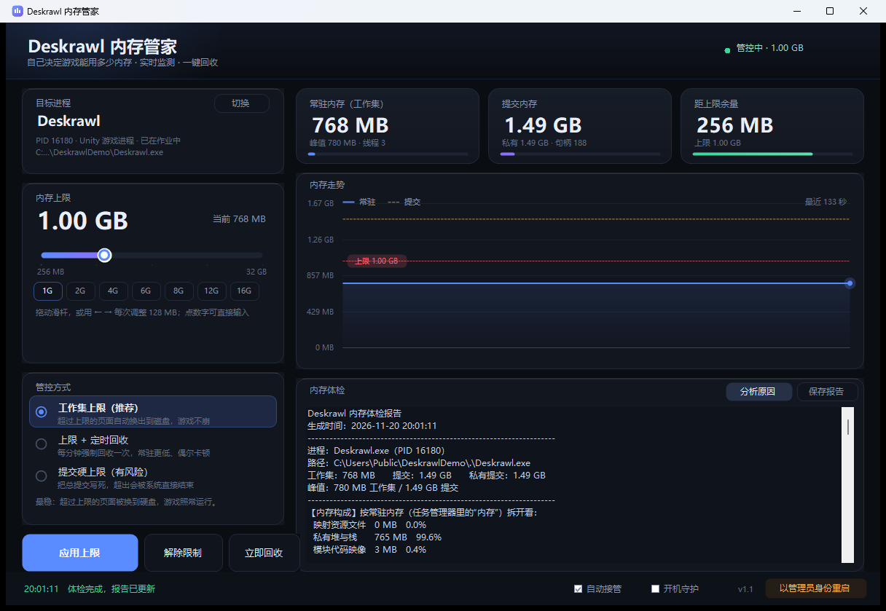

<div align="center">

# Deskrawl 内存管家

**别让游戏替你决定电脑该用多少内存。**

拖一根滑杆，给 `Deskrawl.exe` 划一条红线；它再怎么加载资源，也涨不过这条线。

一个 80 KB 的单文件小工具 · 免安装 · 不需要 Python / 不需要 .NET SDK

[](https://github.com)
[](https://dotnet.microsoft.com)
[](LICENSE)
[](AI-DISCLOSURE.md)

[下载](#-下载) · [为什么它吃内存](docs/Deskrawl内存分析.md) · [三种管控方式](#-三种方式怎么选) · [命令行](#-命令行可选) · [自己编译](#-自己编译)

</div>



---

## 这是什么

Deskrawl 是 Unity 6 做的游戏，启动时就把 1.2 GB 的资源包映射进内存，跑起来之后堆只涨不缩，于是任务管理器里的数字一路往上爬，最后把整台机器挤得只剩几百 MB。**这中间没有哪一步是"泄漏"，它只是从来不还。**

这个工具做的事很简单：从外面给进程套一个 Windows 原生内存配额，让系统在它超线时把冷页换到硬盘。游戏照常跑，但你的 RAM 归你管。

- **一根滑杆定生死** —— 256 MB ~ 32 GB，对数刻度，拖到哪就是哪
- **三种力度** —— 温柔的工作集上限 / 定时回收 / 硬核的提交上限
- **看得见** —— 实时曲线对比「常驻」「提交」和你设的红线
- **说得清** —— 一键体检，把内存拆成资源映射 / 私有堆 / 代码映像，并给出建议值
- **记得住** —— 配置持久化，游戏重启后自动重新接管
- **能脚本化** —— `--cli` 提供 list / stat / apply / release / snapshot / watch

## 下载

前往 [**Releases**](../../releases/latest) 下载 `DeskrawlMemGovernor.exe`（或整个 zip）。解压即用，无需安装。

> Windows 可能弹出 SmartScreen「Windows 已保护你的电脑」——点「更多信息」→「仍要运行」。单文件、无签名的小工具都会这样。

## 快速开始

1. 双击 `DeskrawlMemGovernor.exe`
2. 启动 Deskrawl —— 程序会自动识别并接管 `Deskrawl.exe`
3. 拖动「内存上限」滑杆（或直接点数字输入，如 `4096`），点 **应用上限**
4. 完事。红线以下随它跑，超过的部分系统自动换页

正常情况**不需要管理员权限**（同一用户下的进程都能管）。只有当游戏本身以管理员身份运行时，才需要点右下角「以管理员身份重启」。

## 界面怎么看

```
┌─ 目标进程 ──────── 自动识别 Deskrawl.exe，点「切换」也能管别的程序
├─ 内存上限 ──────── 滑杆决定它能占多少；点数字可精确输入
├─ 管控方式 ──────── 三种策略，默认第一种（推荐）
├─ 应用上限 / 解除限制 / 立即回收
├─ 常驻 / 提交 / 余量 ─ 三张实时卡片（进度条 = 占「你设的上限」的比例）
├─ 内存走势 ──────── 蓝面=常驻，橙虚线=提交，红虚线=你划的红线
└─ 内存体检 ──────── 点「分析原因」，拆开内存构成并给建议值
```

底部两个勾选框：`自动接管`（游戏重启后自动重新套用上限）、`开机守护`（登录后自动启动本程序）。

## 三种方式怎么选

| 方式 | 游戏里的感觉 | 什么时候用 |
|---|---|---|
| **工作集上限（推荐）** | 几乎无感，偶尔读盘轻微卡一下 | 日常都用这个 |
| **上限 + 定时回收** | 每 20 秒可能顿一下，常驻更低 | 内存实在紧张，后台还开着浏览器 |
| **提交硬上限（有风险）** | 超了直接闪退 | 强制自律，清楚自己在干什么 |

**建议值（16 GB 内存）**：日常 4～6 GB；只玩游戏 8 GB；小地图低画质 3 GB。
**别低于 1.5 GB** —— Unity 加载资源需要这么多，压太狠会疯狂读盘，反而更卡。

## 为什么 Deskrawl 这么吃内存

一句话版：**它不是泄漏，是"峰值吃满内存之后不还回去"。**

| 内存去哪了 | 大约多少 |
|---|---|
| `sharedassets0.assets.resS` 资源包文件映射 | ~1.2 GB（系统可随时丢弃，但任务管理器会算进"提交"） |
| Unity 6 IL2CPP + Boehm 保守式 GC 的堆 | 只涨不缩，常见 1～3 GB |
| doorstop 注入进游戏进程的完整 .NET / CoreCLR | ~200 MB 起 |
| 透明窗口每帧重绘 + 420 条材质警告刷屏 | 持续小额增长 |

为什么"越玩越涨"、任务管理器里的"提交"为什么能涨到几个 GB 而实际内存却没被吃光、页面文件 56.9 GB 在其中起什么作用——都写在 **[docs/Deskrawl内存分析.md](docs/Deskrawl内存分析.md)** 里，带实测数据。

## 命令行（可选）

```bat
DeskrawlMemGovernor.exe --cli list
DeskrawlMemGovernor.exe --cli stat     --pid 1234
DeskrawlMemGovernor.exe --cli apply    --pid 1234 --limit 4096 --mode cap
DeskrawlMemGovernor.exe --cli apply    --pid 1234 --limit 4096 --mode trim
DeskrawlMemGovernor.exe --cli release  --pid 1234
DeskrawlMemGovernor.exe --cli snapshot --pid 1234 --out 报告.txt
DeskrawlMemGovernor.exe --cli watch    --name Deskrawl.exe --limit 4096 --interval 3
```

- `--limit` 单位 MB；`--mode`：`cap` 工作集上限 / `trim` 上限+回收 / `commit` 提交硬上限
- `watch` 适合做成计划任务：一直守着，游戏一启动就接管

## 常见问题

**设了上限，游戏会崩吗？**
工作集上限不会。它只是把不常用的页换到硬盘，要用时再读回来——可能卡顿，不会崩溃。「提交硬上限」才会让游戏闪退，那是它的设计目的。

**任务管理器里为什么还显示提交很大？**
提交 ≠ 常驻。提交是"预约"，工作集才是"真占着 RAM"。你真正要压的是后者，本工具压的也是后者。

**回收之后立刻又涨回去？**
说明它正在活跃使用这批内存（比如加载新地图）。这时上限会自动挡住，不需要反复点回收。

**点了没反应 / 提示权限不足？**
先点右下角「以管理员身份重启」。Windows 不允许跨用户、跨权限级别改别人的进程配额。

**想彻底不管了？**
点「解除限制」，或直接关掉本程序——配额句柄跟着进程走，进程一退，上限自动失效。

**配置存在哪？**
exe 同目录的 `deskrawl-mem.conf`；目录不可写时退到 `%APPDATA%\DeskrawlMem\config.conf`。开机自启写在 `HKCU\Software\Microsoft\Windows\CurrentVersion\Run\DeskrawlMemGovernor`，取消勾选即删除。

## 它到底做了什么（技术细节）

| 能力 | 用的 Windows API |
|---|---|
| 工作集硬上限 | `SetProcessWorkingSetSizeEx(h, min=1, max=cap, QUOTA_LIMITS_HARDWS_MAX_ENABLE)` |
| 立即回收 | `EmptyWorkingSet(h)`（注意：在 **psapi.dll**，不在 kernel32） |
| 提交硬上限 | `CreateJobObjectW` + `SetInformationJobObject(JobObjectExtendedLimitInformation, JOB_OBJECT_LIMIT_PROCESS_MEMORY)` + `AssignProcessToJobObject` |
| 降低回收优先级 | `SetProcessInformation(ProcessMemoryPriority, VERY_LOW)` |
| 内存构成体检 | `VirtualQueryEx` + `QueryWorkingSetEx` + `EnumProcessModulesEx` + `GetMappedFileNameW` |

几个实测踩出来的坑（写在这里免得后人再踩一遍）：

- `SetProcessWorkingSetSizeEx` 的 min 必须 > 0，传 0 直接 `ERROR_INVALID_PARAMETER`；传 1 字节就行。
- 解除上限用 1 TB 或 `QUOTA_LIMITS_HARDWS_MAX_DISABLE`，但**工作集不会自动涨回去**，要等进程自己再访问那些页。
- `AssignProcessToJobObject` 对已运行的进程需要 `PROCESS_SET_QUOTA | PROCESS_TERMINATE`，只给查询权限会 `Access Denied`。
- 进程已经在别的作业里也能再加入（Windows 8+ 支持嵌套作业）。
- 所有 `DllImport` 都要 `CharSet = CharSet.Unicode`，否则 `StringBuilder` 按 ANSI 读 UTF-16，路径只会取到第一个字符。

## 自己编译

系统自带的 .NET Framework 4.x 就够了，不需要装 SDK：

```bat
build.cmd
```

源码只有四个文件：

| 文件 | 职责 |
|---|---|
| `src/Core.cs` | 进程枚举、配额施加、内存体检、报告生成、CLI 后端 |
| `src/Ui.cs` | 深色主题与全部自绘控件（卡片、按钮、滑杆、曲线、统计卡） |
| `src/MainForm.cs` | 主窗体、布局、事件、配置持久化 |
| `src/Program.cs` | 入口、`--cli`、全局异常兜底 |

注意：目标框架是 C# 5（用 `csc.exe` 编译），**不能用字符串插值、`nameof`、表达式体成员、元组**。

## 边界（说清楚免得误会）

- 它管的是**工作集与提交**，不改游戏内部逻辑；游戏想申请多少还会申请，只是超出的部分被换到硬盘。
- 它不减少硬盘里的资源包，也不修 Unity 的 GC 行为。
- 上限对**单个进程**生效。游戏、助手、Steam 各自独立，想一起管就在「切换」里逐个接管。
- 游戏更新后若进程名变了，用「切换」手动选一次即可。

## 关于 AI 参与开发

这个项目**绝大部分代码是 AI 写的**，人类负责提需求、实测、挑毛病和拍板。完整说明见 [AI-DISCLOSURE.md](AI-DISCLOSURE.md)。

我们不打算藏着这件事：Windows 内存配额这套 API 的坑（min 传 0 报错、`EmptyWorkingSet` 在 psapi 而非 kernel32、作业对象要 `PROCESS_SET_QUOTA`）有一半是 AI 踩了、被测出来、再修掉的。工具本身好用就行，代码怎么来的写清楚就行。

## 许可证

[MIT](LICENSE) —— 随便用、随便改、随便发，出事别找我。
